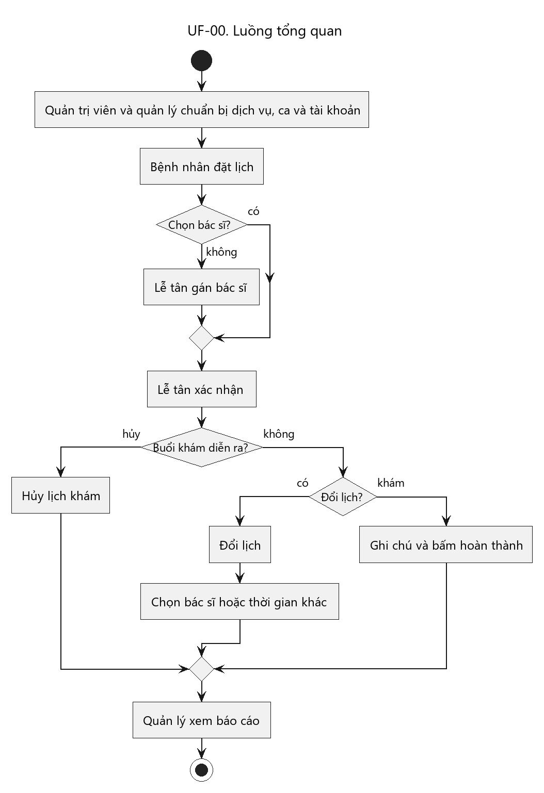
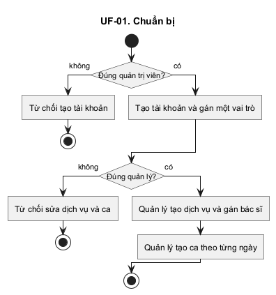
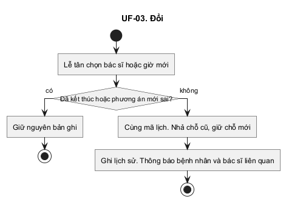
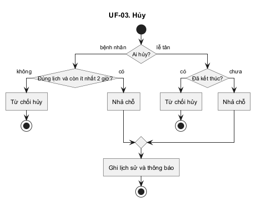
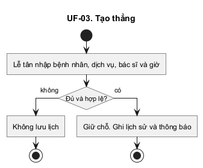
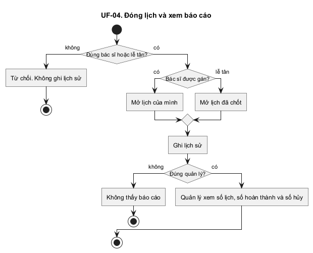

# User Flow

## 1. Sơ đồ hệ thống

State hiện có:
- Pending: chưa gán bác sĩ, chưa giữ chỗ
- Reserved: đã gán bác sĩ, đang giữ chỗ, lễ tân chưa xác nhận
- Confirmed: đã xác nhận, đang giữ chỗ
- Completed: đã khám xong, chỗ đã dùng cho buổi khám
- Cancelled: đã hủy, đã nhả chỗ

## 2. Sơ đồ chuẩn bị masterdata và ca làm việc

## 3. Sơ đồ đặt lịch

## 4. Sơ đồ xác nhận lịch

## 5. Sơ đồ đổi lịch

## 6. Sơ đồ hủy lịch

## 7. Sơ đồ lễ tân tạo lịch hẹn

## 8. Sơ đồ đóng lịch và báo cáo

