# Tài liệu User Flow — ViClinic

## 1. Quy ước vòng đời lịch hẹn

| Trạng thái | Diễn giải | Chuyển tiếp chính |
| :--- | :--- | :--- |
| `PENDING` | Lịch chờ Lễ tân xác nhận; có thể đã hoặc chưa gán bác sĩ. | `CONFIRMED`, `CANCELLED` |
| `CONFIRMED` | Lịch đã được xác nhận và đã có bác sĩ. | `COMPLETED`, `CANCELLED`, hoặc đổi bác sĩ/thời gian trên cùng lịch |
| `COMPLETED` | Buổi khám đã được Bác sĩ/Lễ tân ghi nhận hoàn tất. | Kết thúc |
| `CANCELLED` | Lịch đã bị hủy. | Kết thúc |

---

## 2. Danh mục User Flow

### UF-00 — Luồng tổng quan lịch hẹn
Tổng quan từ đặt lịch, xác nhận, điều phối đến hoàn thành/hủy.

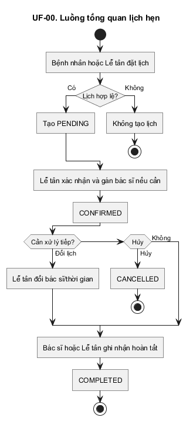

### UF-01 — Đăng nhập
Người dùng đăng nhập bằng số điện thoại và mật khẩu để truy cập các chức năng được phép.

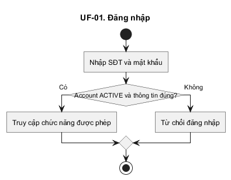

### UF-02 — Quản lý dịch vụ và năng lực bác sĩ
Quản lý cấu hình dịch vụ, thời lượng khám và bác sĩ có thể thực hiện từng dịch vụ.

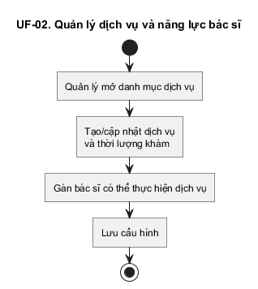

### UF-03 — Đặt lịch
Bệnh nhân tự đặt lịch hoặc Lễ tân đặt thay cho bệnh nhân.

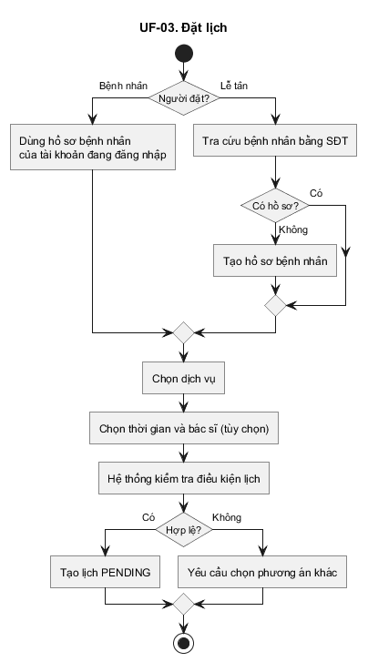

### UF-04 — Xác nhận lịch
Lễ tân xử lý lịch `PENDING`, gán bác sĩ nếu cần và xác nhận lịch.

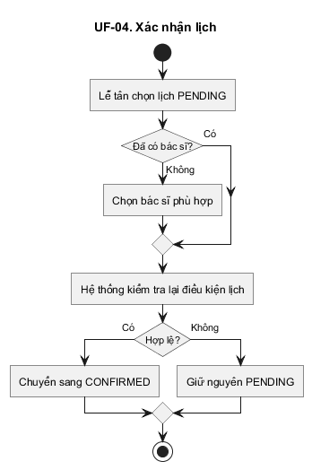

### UF-05 — Đổi lịch
Lễ tân đổi bác sĩ hoặc thời gian trên cùng lịch `PENDING`/`CONFIRMED`.

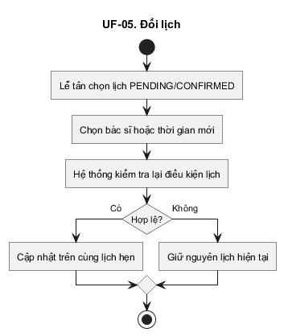

### UF-06 — Hủy lịch
Bệnh nhân tự hủy theo quy tắc 2 giờ hoặc Lễ tân hỗ trợ hủy.

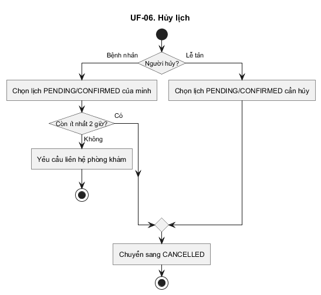

### UF-07 — Lễ tân tạo lịch đã xác nhận
Lễ tân tạo trực tiếp lịch `CONFIRMED` khi đủ hồ sơ bệnh nhân, dịch vụ, bác sĩ và thời gian hợp lệ.

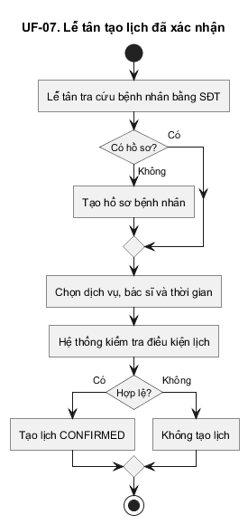

### UF-08 — Hoàn thành lịch
Bác sĩ được gán hoặc Lễ tân ghi nhận lịch `CONFIRMED` đã hoàn tất.

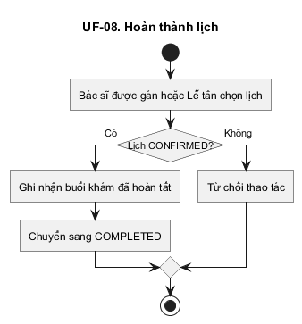

### UF-09 — Báo cáo
Quản lý xem báo cáo lịch hẹn theo khoảng thời gian/bác sĩ.

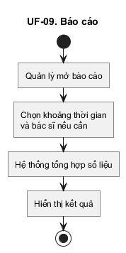

### UF-10 — Đăng ký bệnh nhân
Bệnh nhân đăng ký bằng số điện thoại; hệ thống tái sử dụng người dùng hiện có nếu số điện thoại đã tồn tại và không tạo hồ sơ/account trùng.

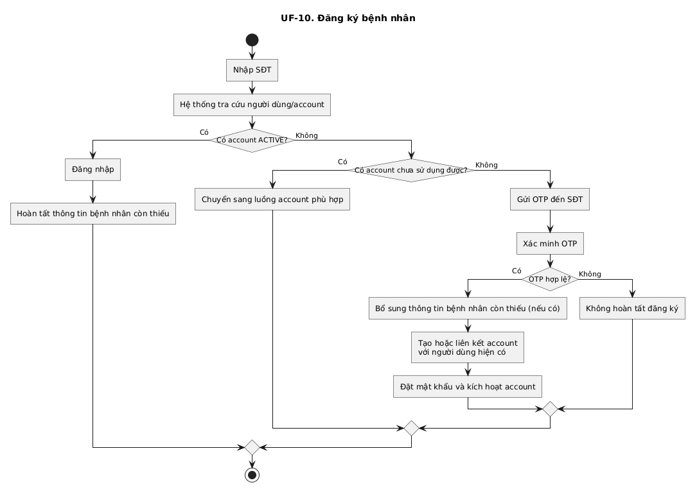

### UF-11 — Kích hoạt tài khoản nhân viên
Nhân viên kích hoạt account do Admin tạo bằng OTP và đặt mật khẩu.

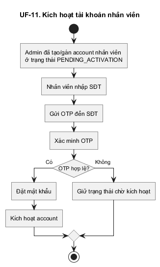

### UF-12 — Khôi phục mật khẩu
Người dùng có account `ACTIVE` xác minh OTP và đặt mật khẩu mới.

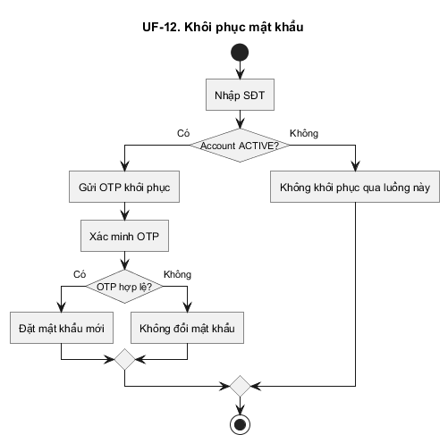

### UF-13 — Kích hoạt lại tài khoản
Admin cho phép kích hoạt lại account `DISABLED`; chính chủ xác minh OTP để chuyển lại `ACTIVE`.

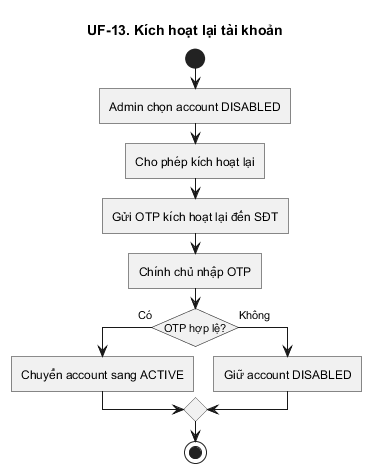

### UF-14 — Quản lý ca làm việc bác sĩ
Quản lý tạo/sửa ca làm việc; hệ thống từ chối ca chồng lấn và xác định các lịch bị ảnh hưởng để Lễ tân xử lý.

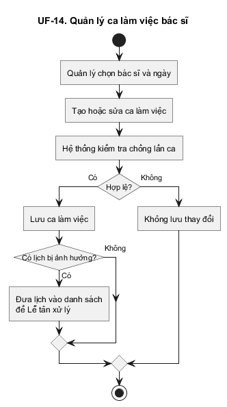

### UF-15 — Bác sĩ báo không sẵn sàng
Bác sĩ khai báo khoảng thời gian không sẵn sàng; các lịch bị ảnh hưởng được chuyển cho Lễ tân xử lý thủ công.

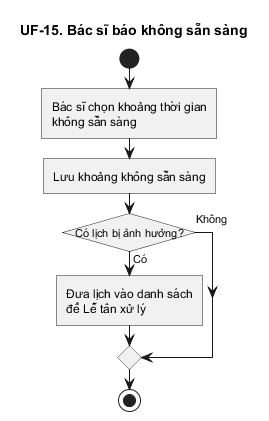

---

## 3. Ma trận truy vết User Flow ↔ FR ↔ NFR

| User Flow | FR chính | NFR chính |
| :--- | :--- | :--- |
| UF-00 Tổng quan lịch hẹn | M02, M03 | NFR-004, NFR-008 |
| UF-01 Đăng nhập | FR-M01-003, FR-M01-004 | NFR-002, NFR-012 |
| UF-02 Quản lý dịch vụ & năng lực bác sĩ | FR-M02-001 | NFR-008 |
| UF-03 Đặt lịch | FR-M01-005, FR-M02-002, FR-M02-003, FR-M02-004, FR-M02-007, FR-M02-008 | NFR-004, NFR-007, NFR-008 |
| UF-04 Xác nhận lịch | FR-M02-005, FR-M02-007 | NFR-004, NFR-007 |
| UF-05 Đổi lịch | FR-M02-011, FR-M02-007 | NFR-004, NFR-007 |
| UF-06 Hủy lịch | FR-M02-010 | NFR-008 |
| UF-07 Tạo lịch đã xác nhận | FR-M01-005, FR-M02-006, FR-M02-007, FR-M02-008 | NFR-004, NFR-007 |
| UF-08 Hoàn thành lịch | FR-M02-009 | NFR-008 |
| UF-09 Báo cáo | FR-M04-001 | NFR-001, NFR-002 |
| UF-10 Đăng ký bệnh nhân | FR-M01-001 | NFR-008, NFR-012, NFR-013 |
| UF-11 Kích hoạt tài khoản nhân viên | FR-M01-002 | NFR-008, NFR-012, NFR-013 |
| UF-12 Khôi phục mật khẩu | FR-M01-006 | NFR-008, NFR-012, NFR-013 |
| UF-13 Kích hoạt lại tài khoản | FR-M01-002 | NFR-008, NFR-013 |
| UF-14 Quản lý ca làm việc bác sĩ | FR-M03-001, FR-M03-004 | NFR-004, NFR-008 |
| UF-15 Bác sĩ báo không sẵn sàng | FR-M03-002, FR-M03-004 | NFR-008 |