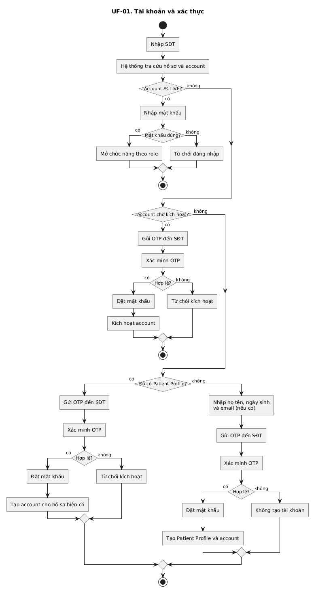

# Tài liệu User Flow — ViClinic

Tài liệu này đặc tả các luồng nghiệp vụ người dùng (User Flows) trong hệ thống Quản lý Lịch hẹn Phòng khám ViClinic, kèm ma trận truy vết với Yêu cầu Chức năng ([FR.md](FR.md)) và Yêu cầu Phi chức năng ([NFR.md](NFR.md)).

---

## 1. Quy ước Vòng đời & Trạng thái Lịch hẹn

Hệ thống thống nhất sử dụng 4 trạng thái lịch hẹn và quy tắc giữ slot bác sĩ như sau:

| Trạng thái | Diễn giải nghiệp vụ | Quy tắc giữ slot Bác sĩ | Chuyển tiếp hợp lệ |
| :--- | :--- | :--- | :--- |
| **`PENDING`** | Lịch hẹn chờ xác nhận được tạo bởi Bệnh nhân hoặc Lễ tân. | - **Chưa chọn BS:** Không chiếm giữ slot. - **Đã chọn/gán BS:** Giữ tạm slot của BS đó để tránh bị đặt trùng. | Chuyển sang `CONFIRMED` hoặc `CANCELLED`. |
| **`CONFIRMED`** | Lịch hẹn đã được xác nhận (bắt buộc đã gán BS và kiểm tra điều kiện lịch). | **Chiếm giữ** slot làm việc của bác sĩ. | Chuyển sang `COMPLETED`, `CANCELLED` hoặc cập nhật giờ/BS mới trên cùng lịch. |
| **`COMPLETED`** | Lịch khám đã hoàn tất bởi Bác sĩ hoặc Lễ tân. | Đã sử dụng (kết thúc phiên khám). | Trạng thái kết thúc (Terminal State), không thể đổi hoặc hủy. |
| **`CANCELLED`** | Lịch hẹn bị hủy bởi Bệnh nhân (trước $\ge$ 2 giờ) hoặc Lễ tân. | **Giải phóng** slot của bác sĩ ngay lập tức. | Trạng thái kết thúc (Terminal State), không thể khôi phục. |

---

## 2. Danh mục Sơ đồ User Flow

### 0. Luồng tổng quan (UF-00)
Mô tả bức tranh toàn cảnh các bước từ chuẩn bị lịch, đặt lịch, xác nhận, điều phối đổi/hủy đến khi hoàn thành lịch khám.

### 1. Tài khoản và xác thực (UF-01)
Luồng đăng nhập theo vai trò, xác minh OTP kích hoạt tài khoản và tái sử dụng hồ sơ bệnh nhân khi đăng ký mới.

### 2. Chuẩn bị dịch vụ và lịch bác sĩ (UF-02)
Luồng Quản lý thiết lập dịch vụ, thời lượng, phân ca làm việc, Bác sĩ khai báo thời gian không sẵn sàng, và xử lý lịch bị ảnh hưởng.

### 3. Đặt lịch (UF-03)
Luồng Bệnh nhân tự đặt lịch online hoặc Lễ tân đặt lịch thay cho bệnh nhân, hỗ trợ chọn hoặc chưa chọn bác sĩ.

### 4. Xác nhận lịch (UF-04)
Luồng Lễ tân rà soát lịch `PENDING`, gán bác sĩ phù hợp (nếu chưa có) và chuyển trạng thái sang `CONFIRMED`.

### 5. Đổi lịch (UF-05)
Luồng Lễ tân điều chỉnh thời gian hoặc đổi bác sĩ trên cùng một lịch hẹn chưa kết thúc, bảo đảm kiểm tra lại xung đột.

### 6. Hủy lịch (UF-06)
Luồng hủy lịch hẹn áp dụng quy tắc 2 giờ đối với Bệnh nhân và quyền xử lý linh hoạt của Lễ tân.

### 7. Lễ tân tạo lịch đã xác nhận (UF-07)
Luồng tạo trực tiếp lịch `CONFIRMED` tại quầy tiếp đón khi đã đầy đủ thông tin bệnh nhân, dịch vụ, bác sĩ và thời gian.

### 8. Hoàn thành lịch (UF-08)
Luồng Bác sĩ được gán hoặc Lễ tân ghi nhận hoàn thành buổi khám và đóng lịch.

### 9. Báo cáo (UF-09)
Luồng Quản lý phòng khám tra cứu, lọc và tổng hợp số liệu lịch hẹn, tỷ lệ hoàn thành/hủy phục vụ vận hành.

---

## 3. Ma trận Truy vết (Traceability Matrix: User Flow ↔ FR ↔ NFR)

Ma trận bảo đảm tính nhất quán và khả năng truy vết nguồn gốc (Traceability) giữa các sơ đồ luồng người dùng với Yêu cầu Chức năng ([FR.md](FR.md)) và Yêu cầu Phi chức năng ([NFR.md](NFR.md)):

| Mã Sơ đồ | Tên User Flow | Yêu cầu Chức năng liên quan (FR) | Yêu cầu Phi chức năng liên quan (NFR) |
| :---: | :--- | :--- | :--- |
| **UF-00** | Luồng tổng quan hệ thống | Bao quát toàn bộ Module M02, M03, M04 | [NFR-008](NFR.md) (Hoàn tất workflow), [NFR-009](NFR.md) (Nền tảng Web duy nhất) |
| **UF-01** | Tài khoản và xác thực | [FR-M01-001](FR.md) (Đăng ký bệnh nhân) [FR-M01-002](FR.md) (Tài khoản nhân viên) [FR-M01-003](FR.md) (Đăng nhập) [FR-M01-004](FR.md) (Phân quyền dữ liệu) [FR-M01-005](FR.md) (Hồ sơ bệnh nhân) | [NFR-002](NFR.md) (Kiểm soát truy cập theo vai trò) [NFR-012](NFR.md) (Bảo vệ mật khẩu) [NFR-013](NFR.md) (Xác minh OTP an toàn) |
| **UF-02** | Chuẩn bị dịch vụ & ca làm việc | [FR-M02-001](FR.md) (Quản lý dịch vụ/bác sĩ) [FR-M03-001](FR.md) (Quản lý ca làm việc) [FR-M03-002](FR.md) (Đánh dấu không sẵn sàng) [FR-M03-004](FR.md) (Xử lý lịch bị ảnh hưởng) | [NFR-004](NFR.md) (Không lưu lịch chồng lấn) [NFR-008](NFR.md) (Hoàn tất workflow) |
| **UF-03** | Đặt lịch hẹn | [FR-M02-002](FR.md) (Xem bác sĩ & giờ trống) [FR-M02-003](FR.md) (Đặt lịch hẹn) [FR-M02-004](FR.md) (Quy tắc giữ slot) [FR-M02-007](FR.md) (Chặn trùng lịch) [FR-M02-008](FR.md) (Ràng buộc khung giờ) | [NFR-004](NFR.md) (Chặn overlap đồng thời) [NFR-008](NFR.md) (Hoàn tất workflow không mất dữ liệu) |
| **UF-04** | Xác nhận lịch hẹn | [FR-M02-005](FR.md) (Gán bác sĩ & xác nhận) [FR-M02-007](FR.md) (Chặn trùng lịch) [FR-M02-012](FR.md) (Ghi lịch sử thay đổi) [FR-M03-003](FR.md) (Gửi thông báo nội bộ) | [NFR-004](NFR.md) (Không lưu lịch chồng lấn) [NFR-005](NFR.md) (Đủ dấu vết thay đổi) [NFR-006](NFR.md) (Thông báo in-app không phụ thuộc SMS ngoài) [NFR-007](NFR.md) (Thao tác lễ tân $\le$ 60 giây) |
| **UF-05** | Đổi lịch hẹn | [FR-M02-011](FR.md) (Đổi bác sĩ / thời gian) [FR-M02-007](FR.md) (Chặn trùng lịch) [FR-M02-012](FR.md) (Ghi lịch sử thay đổi) [FR-M03-003](FR.md) (Gửi thông báo nội bộ) | [NFR-004](NFR.md) (Không lưu lịch chồng lấn) [NFR-005](NFR.md) (Đủ dấu vết thay đổi) [NFR-006](NFR.md) (Thông báo nội bộ) [NFR-007](NFR.md) (Thao tác lễ tân $\le$ 60 giây) |
| **UF-06** | Hủy lịch hẹn | [FR-M02-010](FR.md) (Hủy lịch & quy tắc 2 giờ) [FR-M02-012](FR.md) (Ghi lịch sử thay đổi) [FR-M03-003](FR.md) (Gửi thông báo nội bộ) | [NFR-004](NFR.md) (Giải phóng slot hợp lệ) [NFR-005](NFR.md) (Đủ dấu vết thay đổi) [NFR-006](NFR.md) (Thông báo nội bộ) |
| **UF-07** | Lễ tân tạo lịch đã xác nhận | [FR-M02-006](FR.md) (Tạo thẳng CONFIRMED) [FR-M02-007](FR.md) (Chặn trùng lịch) [FR-M02-008](FR.md) (Ràng buộc ca làm việc) [FR-M02-012](FR.md) (Ghi lịch sử thay đổi) [FR-M03-003](FR.md) (Gửi thông báo nội bộ) | [NFR-004](NFR.md) (Không lưu lịch chồng lấn) [NFR-005](NFR.md) (Đủ dấu vết thay đổi) [NFR-006](NFR.md) (Thông báo nội bộ) [NFR-007](NFR.md) (Thao tác lễ tân $\le$ 60 giây) |
| **UF-08** | Hoàn thành lịch hẹn | [FR-M02-009](FR.md) (Hoàn thành lịch) [FR-M02-012](FR.md) (Ghi lịch sử thay đổi) | [NFR-005](NFR.md) (Đủ dấu vết thay đổi với actor + thời điểm) |
| **UF-09** | Báo cáo thống kê | [FR-M04-001](FR.md) (Xem báo cáo lịch hẹn) | [NFR-001](NFR.md) (Thời gian phản hồi báo cáo $<$ 2 giây) [NFR-002](NFR.md) (Phân quyền truy cập báo cáo) [NFR-010](NFR.md) (Quy mô kiểm chứng 1.000 lịch & 5 bác sĩ) |
