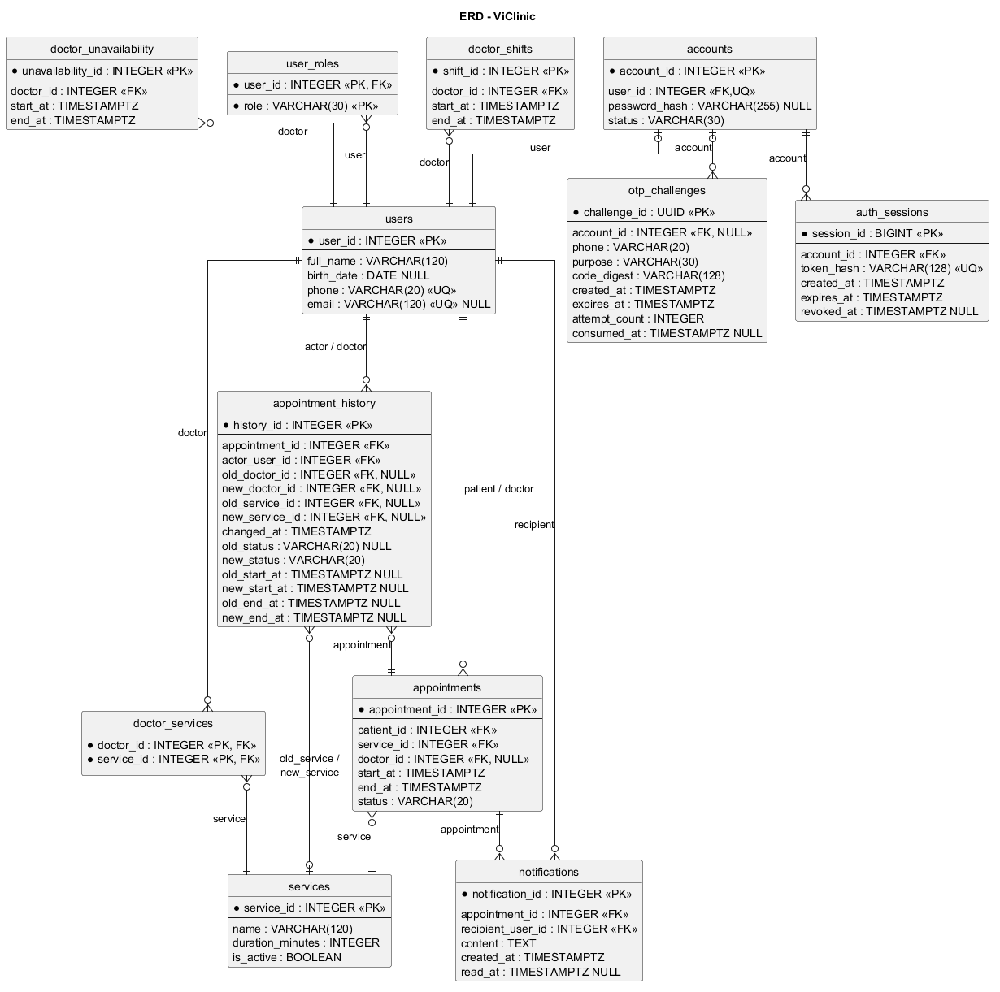

# Data Dictionary

## 1. Quy ước chung

| Nội dung | Quy ước |
| --- | --- |
| DBMS | PostgreSQL |
| Khóa chính | `INTEGER`; `auth_sessions` dùng `BIGINT`, `otp_challenges` dùng `UUID` |
| Thời điểm nghiệp vụ | `TIMESTAMPTZ` |
| Múi giờ hiển thị | `Asia/Ho_Chi_Minh` |
| Khoảng thời gian lịch | `[start_at, end_at)` |
| Vai trò | `PATIENT`, `RECEPTIONIST`, `DOCTOR`, `CLINIC_MANAGER`, `ADMIN` |
| Trạng thái account | `PENDING_ACTIVATION`, `ACTIVE`, `DISABLED` |
| Trạng thái appointment | `PENDING`, `CONFIRMED`, `COMPLETED`, `CANCELLED` |
| Số điện thoại | Bắt buộc, chuẩn hóa trước khi kiểm tra `UNIQUE` |

## 2. `users`

Lưu danh tính người dùng. Một người chỉ có một bản ghi `users`; vai trò được lưu riêng tại `user_roles`.

| Thuộc tính | Kiểu dữ liệu | Khóa / Ràng buộc | Null | Mô tả |
| --- | --- | --- | --- | --- |
| `user_id` | INTEGER | PK | Không | Mã người dùng |
| `full_name` | VARCHAR(120) |  | Không | Họ tên |
| `birth_date` | DATE | Bắt buộc khi tạo hoặc cập nhật hồ sơ | Có | Ngày sinh từ 01/01/1900 đến hiện tại; cho phép NULL đối với dữ liệu cũ |
| `phone` | VARCHAR(20) | UNIQUE | Không | Số điện thoại chính |
| `email` | VARCHAR(120) | UQ, không phân biệt hoa thường | Có | Email liên hệ |

## 3. `user_roles`

Gán vai trò cho người dùng.

| Thuộc tính | Kiểu dữ liệu | Khóa / Ràng buộc | Null | Mô tả |
| --- | --- | --- | --- | --- |
| `user_id` | INTEGER | PK, FK → `users.user_id` | Không | Người dùng |
| `role` | VARCHAR(30) | PK, CHECK theo danh sách role | Không | Vai trò được gán |

**Ràng buộc nghiệp vụ:** một người có thể có `PATIENT` và tối đa một vai trò nhân viên tại cùng thời điểm.

## 4. `accounts`

Lưu thông tin đăng nhập. Một người có tối đa một account.

| Thuộc tính | Kiểu dữ liệu | Khóa / Ràng buộc | Null | Mô tả |
| --- | --- | --- | --- | --- |
| `account_id` | INTEGER | PK | Không | Mã account |
| `user_id` | INTEGER | FK → `users.user_id`, UNIQUE | Không | Chủ account |
| `password_hash` | VARCHAR(255) |  | Có | Mật khẩu đã băm; có thể rỗng khi chờ kích hoạt |
| `status` | VARCHAR(30) | CHECK theo trạng thái account | Không | Trạng thái account |

## 5. `services`

| Thuộc tính | Kiểu dữ liệu | Khóa / Ràng buộc | Null | Mô tả |
| --- | --- | --- | --- | --- |
| `service_id` | INTEGER | PK | Không | Mã dịch vụ |
| `name` | VARCHAR(120) |  | Không | Tên dịch vụ |
| `duration_minutes` | INTEGER | CHECK `> 0` | Không | Thời lượng khám |
| `is_active` | BOOLEAN | DEFAULT `TRUE` | Không | Có dùng cho lịch mới hay không |

## 6. `doctor_services`

Quan hệ nhiều-nhiều giữa Bác sĩ và Dịch vụ.

| Thuộc tính | Kiểu dữ liệu | Khóa / Ràng buộc | Null | Mô tả |
| --- | --- | --- | --- | --- |
| `doctor_id` | INTEGER | PK, FK → `users.user_id` | Không | Người dùng có role `DOCTOR` |
| `service_id` | INTEGER | PK, FK → `services.service_id` | Không | Dịch vụ bác sĩ có thể thực hiện |

## 7. `doctor_shifts`

| Thuộc tính | Kiểu dữ liệu | Khóa / Ràng buộc | Null | Mô tả |
| --- | --- | --- | --- | --- |
| `shift_id` | INTEGER | PK | Không | Mã ca |
| `doctor_id` | INTEGER | FK → `users.user_id` | Không | Bác sĩ |
| `start_at` | TIMESTAMPTZ |  | Không | Bắt đầu ca |
| `end_at` | TIMESTAMPTZ | CHECK `end_at > start_at` | Không | Kết thúc ca |

## 8. `doctor_unavailability`

| Thuộc tính | Kiểu dữ liệu | Khóa / Ràng buộc | Null | Mô tả |
| --- | --- | --- | --- | --- |
| `unavailability_id` | INTEGER | PK | Không | Mã khoảng không sẵn sàng |
| `doctor_id` | INTEGER | FK → `users.user_id` | Không | Bác sĩ |
| `start_at` | TIMESTAMPTZ |  | Không | Bắt đầu |
| `end_at` | TIMESTAMPTZ | CHECK `end_at > start_at` | Không | Kết thúc |

## 9. `appointments`

| Thuộc tính | Kiểu dữ liệu | Khóa / Ràng buộc | Null | Mô tả |
| --- | --- | --- | --- | --- |
| `appointment_id` | INTEGER | PK | Không | Mã lịch hẹn |
| `patient_id` | INTEGER | FK → `users.user_id` | Không | Người dùng có role `PATIENT` |
| `service_id` | INTEGER | FK → `services.service_id` | Không | Dịch vụ |
| `doctor_id` | INTEGER | FK → `users.user_id` | Có | Người dùng có role `DOCTOR` được gán |
| `start_at` | TIMESTAMPTZ |  | Không | Thời điểm bắt đầu dự kiến |
| `end_at` | TIMESTAMPTZ | CHECK `end_at > start_at` | Không | Thời điểm kết thúc dự kiến |
| `status` | VARCHAR(20) | CHECK theo trạng thái appointment | Không | Trạng thái nghiệp vụ |

**Ràng buộc chính:**
- `CONFIRMED` và `COMPLETED` phải có `doctor_id`.
- Doctor được gán phải thực hiện được Service tương ứng.
- Khi tạo, gán Doctor, xác nhận hoặc đổi lịch, lịch có Doctor phải nằm trong ca làm việc và không giao với khoảng không sẵn sàng.
- Lịch `PENDING`/`CONFIRMED` không được overlap theo bệnh nhân; các lịch đang giữ slot của cùng Doctor không được overlap.

## 10. `appointment_history`

| Thuộc tính | Kiểu dữ liệu | Khóa / Ràng buộc | Null | Mô tả |
| --- | --- | --- | --- | --- |
| `history_id` | INTEGER | PK | Không | Mã lịch sử |
| `appointment_id` | INTEGER | FK → `appointments.appointment_id` | Không | Lịch liên quan |
| `actor_user_id` | INTEGER | FK → `users.user_id` | Không | Người thực hiện |
| `old_doctor_id` | INTEGER | FK → `users.user_id` | Có | Bác sĩ trước thay đổi |
| `new_doctor_id` | INTEGER | FK → `users.user_id` | Có | Bác sĩ sau thay đổi |
| `old_service_id` | INTEGER | FK → `services.service_id` | Có | Dịch vụ trước thay đổi |
| `new_service_id` | INTEGER | FK → `services.service_id` | Có | Dịch vụ sau thay đổi |
| `changed_at` | TIMESTAMPTZ |  | Không | Thời điểm ghi nhận thay đổi |
| `old_status` | VARCHAR(20) |  | Có | Trạng thái trước |
| `new_status` | VARCHAR(20) |  | Không | Trạng thái sau |
| `old_start_at` | TIMESTAMPTZ |  | Có | Giờ bắt đầu dự kiến trước thay đổi |
| `new_start_at` | TIMESTAMPTZ |  | Có | Giờ bắt đầu dự kiến sau thay đổi |
| `old_end_at` | TIMESTAMPTZ |  | Có | Giờ kết thúc dự kiến trước thay đổi |
| `new_end_at` | TIMESTAMPTZ |  | Có | Giờ kết thúc dự kiến sau thay đổi |

## 11. `notifications`

| Thuộc tính | Kiểu dữ liệu | Khóa / Ràng buộc | Null | Mô tả |
| --- | --- | --- | --- | --- |
| `notification_id` | INTEGER | PK | Không | Mã thông báo |
| `appointment_id` | INTEGER | FK → `appointments.appointment_id` | Không | Lịch liên quan |
| `recipient_user_id` | INTEGER | FK → `users.user_id` | Không | Người nhận |
| `content` | TEXT |  | Không | Nội dung thông báo |
| `created_at` | TIMESTAMPTZ |  | Không | Thời điểm tạo |
| `read_at` | TIMESTAMPTZ |  | Có | Thời điểm đọc thông báo |

## 12. `auth_sessions`

Lưu phiên đăng nhập của account.

| Thuộc tính | Kiểu dữ liệu | Khóa / Ràng buộc | Null | Mô tả |
| --- | --- | --- | --- | --- |
| `session_id` | BIGINT | PK | Không | Mã phiên |
| `account_id` | INTEGER | FK → `accounts.account_id` | Không | Chủ phiên |
| `token_hash` | VARCHAR(128) | UNIQUE | Không | Mã phiên đã băm |
| `created_at` | TIMESTAMPTZ |  | Không | Thời điểm tạo |
| `expires_at` | TIMESTAMPTZ |  | Không | Thời điểm hết hạn |
| `revoked_at` | TIMESTAMPTZ |  | Có | Thời điểm thu hồi |

## 13. `otp_challenges`

Lưu yêu cầu xác minh OTP.

| Thuộc tính | Kiểu dữ liệu | Khóa / Ràng buộc | Null | Mô tả |
| --- | --- | --- | --- | --- |
| `challenge_id` | UUID | PK | Không | Mã yêu cầu xác minh |
| `account_id` | INTEGER | FK → `accounts.account_id` | Có | Account liên quan |
| `phone` | VARCHAR(20) |  | Không | Số điện thoại nhận mã |
| `purpose` | VARCHAR(30) | CHECK theo mục đích xác minh | Không | Mục đích xác minh |
| `code_digest` | VARCHAR(128) |  | Không | Giá trị HMAC của mã OTP |
| `created_at` | TIMESTAMPTZ |  | Không | Thời điểm tạo |
| `expires_at` | TIMESTAMPTZ |  | Không | Thời điểm hết hạn |
| `attempt_count` | INTEGER | DEFAULT `0` | Không | Số lần thử xác minh |
| `consumed_at` | TIMESTAMPTZ |  | Có | Thời điểm sử dụng hoặc vô hiệu hóa |

**Mục đích xác minh:** `ACTIVATE`, `RECOVER_PASSWORD`, `REACTIVATE`.

## 14. Quan hệ chính

- `users` 1 — N `user_roles`.
- `users` 1 — 0..1 `accounts`.
- Doctor — Service là M:N qua `doctor_services`.
- Patient 1 — N `appointments`.
- Doctor 0..1 — N `appointments` qua `doctor_id`.
- Service 1 — N `appointments`.
- Doctor 1 — N `doctor_shifts` và `doctor_unavailability`.
- Appointment 1 — N `appointment_history` và `notifications`.
- Service 0..1 — N `appointment_history` qua `old_service_id` và `new_service_id`.
- Account 1 — N `auth_sessions`.
- Account 0..1 — N `otp_challenges`.
